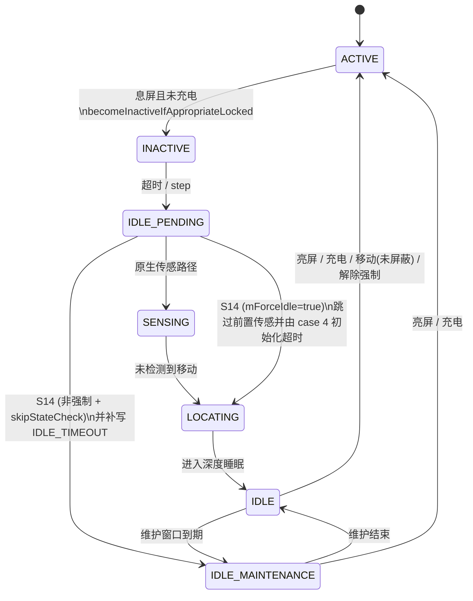

# Doze 状态机、强制深睡链路与阻断因素研究

本文总结 Android / HyperOS（OS1–OS4）中 `DeviceIdleController` 的状态迁移机制、系统拒绝进入深睡的根因、XMillet 强制深睡的四点联动方案以及多通道观测与诊断方法。

## 一、`DeviceIdleController` 状态定义与流转

HyperOS 1–4 沿用 AOSP `DeviceIdleController` 主体状态机；OS3 / OS4 在状态 `0..6` 之外新增了 `QUICK_DOZE_DELAY(7)`。

| 状态值 | 常量名 | 含义 |
| --- | --- | --- |
| `0` | `ACTIVE` | 活动态（亮屏、充电或刚退出 Doze） |
| `1` | `INACTIVE` | 息屏且未充电后进入的初始静置态 |
| `2` | `IDLE_PENDING` | 准备进入深度睡眠的过渡态 |
| `3` | `SENSING` | 静止传感器检测阶段 |
| `4` | `LOCATING` | 定位确认静止阶段 |
| `5` | `IDLE` | 深度睡眠（Deep Doze） |
| `6` | `IDLE_MAINTENANCE` | 深度睡眠维护窗口（短暂放行网络/任务/闹钟后返回 `IDLE`） |
| `7` | `QUICK_DOZE_DELAY` | OS3 / OS4 新增的 Quick Doze 延迟态 |



---

## 二、ROM 侧拒绝进入深睡的阻断条件

核查四代 `DeviceIdleController.java` 后，`becomeInactiveIfAppropriateLocked()` 与 `stepIdleStateLocked(String)` 存在以下核心阻断路径：

| 阻断因素 | ROM 源码判定 | 行为表现 |
| --- | --- | --- |
| 亮屏 / 锁屏边界 | `mScreenOn && !(WAIT_FOR_UNLOCK && mScreenLocked)` | 亮屏期间不会进入 `INACTIVE`；启用 `WAIT_FOR_UNLOCK` 时未解锁前不退出强制或无法正常切换 |
| 充电中 | `mCharging == true` | 正常路径不进入 `INACTIVE` |
| 紧急呼叫 | `isEmergencyCallActive()` | `stepIdleStateLocked` 最前端拒绝进入深睡 |
| 即将到来的唤醒闹钟 | `isUpcomingAlarmClock()`：`elapsedRealtime + MIN_TIME_TO_ALARM(+10m) >= AlarmManager.getNextWakeFromIdleTime()` | 命中时立刻调用 `becomeActiveLocked("alarm")` 再回到 `INACTIVE(1)`；部分即时通讯应用（如携带 `FLAG_WAKE_FROM_IDLE` 的 15 分钟周期 `RTC_WAKEUP` 闹钟）会使该条件长期命中，导致 `force-idle deep` 停在 `INACTIVE` |
| 阻塞型约束 | `mNumBlockingConstraints != 0` | 在无运动传感器回退分支中未豁免 `mForceIdle`，存在活跃约束时直接中断状态推进 |
| Quick Doze 自锁（OS3/OS4） | `mQuickDozeActivated` 分支 | 状态被打回 `QUICK_DOZE_DELAY(7)`，推进循环在 `7` 与 `1` 之间原地打转 |
| `AlarmManager` 提前唤醒裁切 | `AlarmManagerService#adjustIdleUntilTime(Alarm)` | 进入 `IDLE(5)` 后，距下次 `FLAG_WAKE_FROM_IDLE` 闹钟 2–15 分钟时会提前裁切 `mPendingIdleUntil`（≤ 2 分钟时立即触发），导致刚入睡即被拉入 `IDLE_MAINTENANCE(6)` |
| `resetIdleManagementLocked()` 超时归零 | `S14` 改写 `IDLE_PENDING(2) -> IDLE_MAINTENANCE(6)` 后 | `resetIdleManagementLocked()` 会把 `mNextIdleDelay` 与 `mNextIdlePendingDelay` 清零；强制推进若经 `case 6` 进入 `IDLE(5)`，会因延迟为 `0ms` 在数毫秒内假回弹至 `IDLE_MAINTENANCE(6)`，造成短时深睡误记维护次数 |

注：经四代 `DeviceIdleController.java` 与 `millet_pkg` 核验，**官方 Millet 与 Doze 状态机无任何代码关联**，不存在 Millet 阻止系统进入深睡的路径。

---

## 三、XMillet 强制深睡闭环实现

模块在 `system/BroadcastAndDozeHooks.kt`、`core/ConditionalDozeLifecycle.kt` 与 `core/HookDecisions.kt` 中采用四点联动机制打通强制深睡全链路：

### 1. 触发与退出生命周期

1. **息屏排期**：收到 `ACTION_SCREEN_OFF` 且未充电、启用 Doze 增强、服务就绪时，通过 `AlarmManager` 调度 `10s`（`DEEP_DOZE_ENTER_DELAY_MS`）后的精确唤醒闹钟（`XMillet.Screen`）。
2. **冷启动广播补挂**：若系统冷启动早期注册亮灭屏广播失败，按 `1s / 2s / 4s` 指数退避最多自动补挂 3 次。
3. **进入执行（`enterDeepDozeLocked`）**：
   - 先调用 `DeviceIdleController$Shell` 执行 `enable deep` 与 `force-idle deep`；
   - 若系统状态机仍拒绝，清零 `mNumBlockingConstraints` 后最多执行 4 次 `step deep`，抵达 `IDLE(5)` 后补登一次 `force-idle deep`；
   - 仅在仍被硬条件（如紧急呼叫）拒绝时，降级执行 `force-idle light` 兜底。
4. **退出清理**：收到 `ACTION_SCREEN_ON`、`ACTION_POWER_CONNECTED`、配置关闭或热重载时，依次取消待执行闹钟、调用 `unforce` 清除 `mForceIdle`，并在仍停留在 `IDLE`/`IDLE_MAINTENANCE` 时显式调用 `becomeActiveLocked`（兼容 `WAIT_FOR_UNLOCK` 锁屏亮屏场景）。

### 2. 四个核心 Hook 的协同分工

| Hook ID | 目标方法 | 解决的具体问题 | 非强制路径影响 |
| --- | --- | --- | --- |
| `S34` | `DeviceIdleController#isUpcomingAlarmClock` | `mForceIdle == true` 期间全状态短路为 `false`，消除推进循环因 10 分钟闹钟窗口反复回弹 `INACTIVE` 的死锁；紧急呼叫判定位于此方法之前不受影响，携带 `FLAG_WAKE_FROM_IDLE` 的系统闹钟在深睡态仍由 `AlarmManagerService` 准点响铃 | 保持原逻辑 |
| `S42_DOZE_CONSTRAINTS` | `DeviceIdleController#updateActiveConstraintsLocked` | `mForceIdle == true` 且状态位于 `1..4`（`INACTIVE`–`LOCATING`）时清零 `mNumBlockingConstraints`，避免前置阶段阻塞中断 | 保持原逻辑 |
| `S14` | `DeviceIdleController#moveToStateLocked` | 开启 `skipStateCheck` 且进入 `IDLE_PENDING(2)` 时：强制推进改写为 `LOCATING(4)`，由原生 `case 4` 正常初始化 `IDLE_TIMEOUT` 再进入 `IDLE(5)`，消除 `0ms` 假回弹维护；非强制路径改写为 `IDLE_MAINTENANCE(6)` 并主动补写 `mNextIdleDelay` / `mNextIdlePendingDelay` | 按 `skipStateCheck` 开关控制 |
| `S41_ALARM_ADJUST_IDLE_UNTIL` | `AlarmManagerService#adjustIdleUntilTime` | 强制深睡期间跳过对 `FLAG_IDLE_UNTIL` 的提前唤醒裁切并调用 `restoreRequestedTime`，防止临近闹钟时提前拉入 `IDLE_MAINTENANCE` | 保持原逻辑 |

> 历史演进说明：早期版本曾评估并短暂实现过「深睡被拒后 11 分钟闹钟补试（`dozeRetryAfterAlarm`）」；在 `S34` 全状态短路、`S41`、`S42` 与 `S14` 四点闭环打通后，息屏未充电场景已可直接稳定入睡，相关补试开关与调试标记已从代码库移除。

---

## 四、深睡统计的多通道观测与诊断

### 1. 为什么需要 `S14` + `S38` + `S39` + `S40` 四点协同

- **`S14`（`moveToStateLocked`）**：部分 ROM 上该方法体极短且为 `private`，会被 `dex2oat` AOT 内联，导致部分状态切换不进入 Hook。
- **`S38`（`becomeActiveLocked`）**：AOSP / MIUI 退出深睡时直接把 `mState` 置为 `0`（`ACTIVE`），不经过 `moveToStateLocked(0, ...)`。
- **`S39`（`stepIdleStateLocked`）**：在状态步进完成后读取 `mState`，补足进入 `IDLE(5)` 与 `IDLE_MAINTENANCE(6)` 的观测。
- **`S40`（`addEvent(int cmd, String reason)`）**：ROM 每次向事件环记录状态迁移都会调用的极简方法，四代常量与签名一致：
  - `EVENT_DEEP_IDLE(4)` → `IDLE(5)`
  - `EVENT_DEEP_MAINTENANCE(5)` → `IDLE_MAINTENANCE(6)`
  - `EVENT_NORMAL(1)` → `ACTIVE(0)`
  - 浅睡事件（`2` / `3`）直接忽略，避免截断深睡会话。

能力位 `doze_obs` 在上述 4 点全部 `INSTALLED` 时为真，供「运行环境与服务检测」核对观测链路完整性。

### 2. 实时会话与开机回填的区分

- **实时会话**：由 `FreezeStatsRecorder.onDozeStateObserved` 在 `IDLE(5)` 进入与退出时采集电量快照、维护次数（仅 `IDLE(5) -> IDLE_MAINTENANCE(6)` 递增）及各 UID 的 CPU 时间增量（退出时对未曾触发冻结的 Top UID 主动补查包名落盘）。
- **开机回填**：统计查询时按需只读 `DeviceIdleController` 内存环形缓冲区 `mEventCmds` / `mEventTimes`（零轮询），提取本次开机内未落盘的历史深睡区间；回填记录无当时电量与 UID CPU 快照，在统计界面明确标注为「开机回填」。

### 3. 实时状态与失败诊断通道

- **`DozeLiveState`**：按需反射读取 `mState`、`mForceIdle`、`mCharging`、`mScreenOn`、`mNumBlockingConstraints` 及 `mConstraints` 中 `active == true` 的约束名（最多 4 个），随 `TX_GET_RUNTIME_STATUS` 回传至环境检查页。
- **`DozeDiagnostics`**：在 `system_server` 内存记录最近一次主动深睡的尝试、失败与成功时间戳及 ROM 原始拒绝摘要（如 `停在 state=1：Unable to go deep idle; stopped at INACTIVE`），便于不翻日志直接定位卡点。

---

## 五、ADB 现场排查命令

```bash
# 1. 查看 Doze 当前状态、强制标记、亮灭屏与充电状态
adb shell dumpsys deviceidle | grep -E "mDeepEnabled|mForceIdle|mScreenOn|mCharging|mState=|mNumBlockingConstraints"

# 2. 查看是否存在落入 +10m 窗口的 FLAG_WAKE_FROM_IDLE 闹钟
adb shell dumpsys alarm | grep -A2 FLAG_WAKE_FROM_IDLE

# 3. 查看 Doze 事件历史环（验证 deep-idle / deep-maint 迁移）
adb shell dumpsys deviceidle | grep -A30 "Event history:"

# 4. 查看模块 Doze 运行日志（需 Root）
adb shell su -c "tail -n 60 /data/system/XMillet/log"
```
