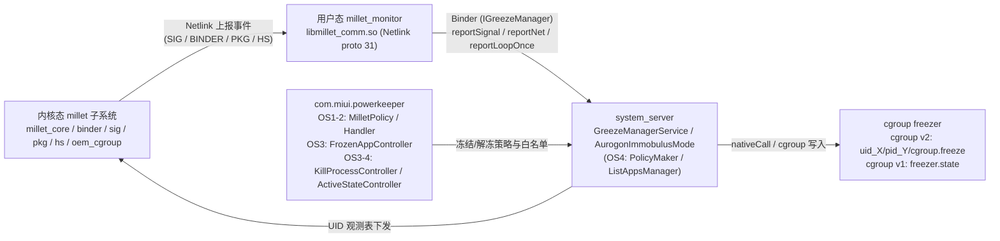

# 小米官方 Millet / Greeze 架构分析（MIUI 14 与 HyperOS 1–4）

本文梳理小米原生墓碑机制（内核 `millet` 子系统、用户态 `millet_monitor`、`system_server` 侧 `GreezeManagerService` / `AurogonImmobulusMode` 及 `com.miui.powerkeeper` 策略层）在多代系统中的结构演进与关键边界。

## 一、端到端架构总览

1. **内核态（`millet_*`）**：通过 Netlink 监听并上报被冻结进程相关的信号、Binder 事务、入向网络包与心跳握手；冻结本身落点在内核 cgroup freezer。
2. **用户态（`millet_monitor` + `libmillet_comm.so`）**：作为内核与 `system_server` 之间的转发守护进程，通过自定义 Netlink 协议号收包，再经 `miui.greeze.IGreezeManager` Binder 接口上报至 `GreezeManagerService`。
3. **系统服务（`system_server`）**：`GreezeManagerService` 维护冻结状态机、执行进程/UID 级冻结与解冻，`AurogonImmobulusMode` 负责场景模式（启动模式、视频模式等）下的冻结准入与前台服务检测；HyperOS 4 将部分策略表与资格判定下沉至 `com.miui.server.greeze.power.PolicyMaker` 与 `ListAppsManager`。
4. **策略宿主（`com.miui.powerkeeper`）**：负责省电策略数据库、云控白名单、亮灭屏/充电调度以及后台查杀决策。

---

## 二、四代 HyperOS 的 Millet 实现对比

| 对比维度 | HyperOS 1（Android 13） | HyperOS 2（Android 14） | HyperOS 3（Android 16） | HyperOS 4（Android 17） |
| --- | --- | --- | --- | --- |
| 内核模块形态 | 内建 `millet_core` | 内建 `millet_core` + `pkg`（Netfilter） | `vendor_boot` ramdisk（LZ4 legacy）内 6 个 `.ko` | 同 OS3，6 个 `.ko` |
| Netfilter 网络记账 | 无 | 仅入向 `pkg_ip4_in` / `pkg_ip6_in` | 入向 `pkg_ip4_in` / `pkg_ip6_in`，出向 `pkg_ip4_out` / `pkg_ip6_out` 直通放行 | 同 OS3，`uid_rec` 线性数组升级为哈希表 |
| `millet_monitor` 路径 | `/system/bin/millet_monitor` | `/system_ext/bin/millet_monitor` | `/system_ext/bin/millet_monitor` | `/system_ext/bin/millet_monitor` |
| 进程模型 | 三进程（`SIG` / `BINDER` / `PKG`） | 三进程（`SIG` / `BINDER` / `PKG`） | 三进程（二进制支持 6 类，rc 启 3 个） | **单进程**，epoll 复用多 socket |
| Netlink 绑定 `nl_pid` | `getpid()` | `getpid()` | `getpid()` | `getpid() + type` |
| cgroup 触发属性 | `persist.sys.millet.cgroup1=true` | `persist.sys.millet.cgroup=true` | `persist.sys.millet.cgroup=true` | `persist.sys.millet.cgroup=true` |
| 报文格式与魔数 | 固定 `0xA0` 缓冲；`src=0x12341234`、`dst=0xABCDDCBA` | 同 OS1 | 同 OS1 | 同 OS1，增加长度下限校验 |
| 是否存在内核丢包 | 否（无 Netfilter 钩子） | 否（恒返回 `NF_ACCEPT`） | 否（恒返回 `NF_ACCEPT`） | 否（恒返回 `NF_ACCEPT`） |

### 1. 内核侧 6 个模块的职责（OS3 / OS4）

| 模块 | 职责与核心符号 |
| --- | --- |
| `millet_core` | Netlink socket（`millet_sk`）、`/proc/millet/{millet_stat,version}`、`register_millet_hook`、黑名单与 UID 记录表；模块参数位于 `/sys/module/millet_core/parameters`（含 `millet_freeze_switch`、`millet_binder_switch`、`frozen_uid_min` 等） |
| `millet_binder` | 监听 Binder 事务与等待状态（`mi_binder_trans_hook` / `mi_binder_reply_hook` / `mi_binder_wait4_hook` / `mi_binder_overflow_hook`），避免在同步调用等待期间错误冻结或及时触发解冻 |
| `millet_sig` | 信号观测（`signals_sendmsg`）；进程冻结期间存在待投递信号时上报 `MILLET_SIG`，触发 `Greeze` 解冻 |
| `millet_hs` | 心跳握手模块（`hs_init_millet` / `hs_recv_hook` / `hs_sendmsg`） |
| `millet_pkg` | 基于 Netfilter 的按 UID IPv4/IPv6 网络包观测（`pkg_ip4_in` / `pkg_ip6_in` / `pkg_ip4_out` / `pkg_ip6_out`），向 `Greeze` 上报 `MILLET_PKG`（对应 `PACKET` 解冻原因） |
| `millet_oem_cgroup` | cgroup 挂载接入（`millet_can_attach` / `freezer_can_attach`），配合 `uid_<uid>/pid_<pid>/cgroup.freeze` 完成进程级冻结 |

### 2. Netlink 协议与握手自愈机制

- **协议号与通道**：使用厂商自定义协议号 `ro.millet.netlink=31`（`AF_NETLINK` / `SOCK_RAW`），`nl_groups = 0`，单播按 `nl_pid` 定向投递。
- **模块类型枚举**：`1 = SIG`、`2 = BINDER`、`3 = BINDER_STAT`、`4 = MEM`、`5 = PKG`、`6 = HANDSHK`。
- **报文结构（固定 `0xA0` 字节接收缓冲）**：
  - `+0x00`：`struct nlmsghdr`（16 字节）
  - `+0x10`：`type`（`u32`，1..6）、`+0x14`：`msg`（`1` = 握手，`2` = 数据）、`+0x18`：`sub`（子类型 1..3）
  - `+0x20` / `+0x28`：源/目的魔数 `0x12341234` / `0xABCDDCBA`（用于校验来源，非网络端口）
  - `+0x30` 起：事件归属 UID、时间戳（`timespec64` 折算毫秒）与信号/附加参数。
- **就绪位掩码与自愈**：
  - `GreezeManagerService` 定义 `MILLET_MONITOR_BINDER = 1`、`MILLET_MONITOR_SIGNAL = 2`、`MILLET_MONITOR_NET = 4`，`MILLET_MONITOR_ALL = 7`。
  - 启动时将 `sys.millet.monitor` 置为 `"1"` 拉起 `millet_monitor`，监视进程就绪后将其写为 `"2"`。
  - `reportLoopOnce()` 仅在 `(mRegisteredMonitor & 7) == 7` 时置位 `milletEnable = true`；若某监视进程异常退出或连续 4 次 `recvmsg` 失败，将 `sys.millet.monitor` 重置为 `"1"` 触发系统重新拉起。

---

## 三、`millet_pkg` 网络行为核验（不丢包结论）

通过对 OS2–OS4 内核与 `millet_pkg.ko` 的反汇编及符号核验：

1. **OS1 不含 Netfilter 网络钩子**：`/sys/module` 仅有 `millet_core`，`millet_monitor` 不含 `reportNet` 符号，OS1 的 Millet 与网络路径无关。
2. **OS2–OS4 的 `pkg_ip4_in` / `pkg_ip6_in` 恒返回 `NF_ACCEPT`**：
   - 入向钩子检查 `IPPROTO_TCP` 与应用 UID（`sock_uid` 属于应用区间），在待上报 UID 表（OS3 为 `uid_rec[256]`，OS4 改为哈希表 `uid_rec_hash_find_and_clear`）中命中后执行原子清零，并发送 `MILLET_PKG` 通知 `Greeze` 评估解冻。
   - **所有代码分支均返回 `1`（`NF_ACCEPT`）**，不存在 `NF_DROP` 或 `NF_STOLEN`；出向 `pkg_ip4_out` / `pkg_ip6_out` 直接返回 `1`。
3. **后台应用无网络或切回前台加载卡死的真实成因**：
   - Android 原生 `netpolicy` 在后台/Doze 下的规则（`blocked=APP_BACKGROUND|DOZE`）；
   - 冻结期间若系统或模块丢弃核心网络状态广播（`CONNECTIVITY_CHANGE`、`WIFI_STATE_CHANGED` 等），应用解冻回前台后无法重建网络状态（XMillet 已在 `S9` / `S10` 放行这 4 类网络状态广播）；
   - Android 13 上若旧广播队列修改 `receiverList.app` 后未恢复，会导致动态接收器永久失效（XMillet 已在 `S10` 的 `finally` 块中恢复）。

---

## 四、内核冻结落点与只读探测（`KernelFreezerDetector`）

- **冻结粒度**：在 cgroup v2 设备上，冻结落点为 **PID 级**（`/sys/fs/cgroup/apps/uid_<uid>/pid_<pid>/cgroup.freeze = 1`），同一 UID 下的不同子进程可独立冻结与解冻。
- **冻结状态确认原则**（见 `system/KernelFreezerDetector.kt`）：
  1. 读取 `/proc/<pid>/cgroup` 并解析对应 cgroup 挂载点下的完成态文件（cgroup v2 需确认 `cgroup.events` 的 `frozen 1`，而不仅是 `cgroup.freeze = 1` 请求位；cgroup v1 核对 `freezer.state`）；
  2. 当状态未与 `RUNNING` 冲突时，辅助核对 `/proc/<pid>/wchan`：`do_freezer_trap` 对应 cgroup v2，`__refrigerator` 对应 cgroup v1；
  3. 同步读取 `GreezeManagerService`（MIUI 14/OS1）或 `GreezeManagerDebugConfig`（OS2–OS4）的 `milletEnable`、`sEnable`、`mPowerMilletEnable` 与 `mRegisteredMonitor` 位掩码，给出 `READY` / `MONITORS_UNREADY` / `DISABLED` / `UNCONFIRMED` 后端判定，全程只读不写控制文件。

---

## 五、双开应用（`userId = 999`）冻结机制跨代演进

Android 双开空间使用 `userId = 999`，UID 形式为 `999 * 100000 + appId`（如 `99910277`），满足 `UserHandle.isApp(uid) == true`，但大于 `19999`。

| 检查位置 | MIUI 14 / OS1 | OS2 | OS3 | OS4 |
| --- | --- | --- | --- | --- |
| `AurogonImmobulusMode` 准入 | 无 `isUidValid`，`updateTargetList` 硬限制 `10000..19999` | `isUidValid` 仅放行 `ENABLE_DOUBLE_APP`（`nuwa`/`ishtar`/`babylon`/`fuxi`）且需云控 `mDoubleAppCtrlCloud` | `isUidValid` 默认放行 `userId == 999`（受 `persist.sys.greeze.doubleapp` 与云控控制） | 同 OS3，已移除 `ENABLE_DOUBLE_APP` 历史字段 |
| `GreezeManagerService#notifyExcuteServices` | 单参重载，`uid > 19999` 直接跳过 | 单参重载，`uid > 19999` 直接跳过 | 改为 3 参重载，放行 `userId == 0 \|\| userId == 999` | 同 OS3 |
| `GreezeManagerService#checkStateForScrOff` | 无此方法 | 硬限制 `uid <= 19999` | 仍保留 `uid <= 19999` | 仍保留 `uid <= 19999` |
| `PowerKeeper` 策略入口 | `MilletPolicy` / `MilletUtils` 全链路卡 `19999` | `MilletUtils#isAppUid` 同卡上述 4 机型白名单 | `FrozenAppController` / `ActiveStateController` 仅校验 `UserHandle.isApp(uid)` | `ActiveStateController` 仅校验 `UserHandle.isApp(uid)` |
| `AppClusterController#isControlApp` | 硬限制 `uid <= 19999` | 硬限制 `uid <= 19999` | 仍保留 `uid <= 19999` | 仍保留 `uid <= 19999` |

XMillet 在双开支持上按代次精准补齐上述缺口：`S31`（MIUI 14/OS1）与 `S28`（OS2–OS4）接管 `Aurogon` 准入，`S29`（OS2–OS4）放开息屏检查，`S30`（OS1/OS2）补齐单参 `notifyExcuteServices`，`P29`（OS2）放开 `MilletUtils#isAppUid`，`P34`（全代次）放开 `AppClusterController#isControlApp`，同时在无 `isUidValid` 的 MIUI 14/OS1 上由 `ForceFreezeBridge` 在灭屏时兜底同步双开冻结目标。
